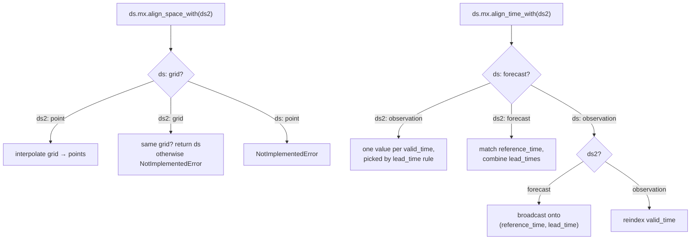

# How alignment works

To compare two datasets element by element, they need the same dimensions and
the same coordinate values along them. mxalign gets them there in two
independent steps, **space** and **time**. The traits of the two datasets
decide what each step does.

## Alignment is chosen from traits

You never call "interpolate grid to points" or "broadcast observations onto
forecast runs" directly. You ask for one dataset to be aligned with another,
and mxalign picks the operation from their traits:



### What is supported

**Time**: all four combinations of forecast and observation.

| `ds` → `ds2` | Result | Options |
|---|---|---|
| forecast → observation | The forecast reshaped to `valid_time`. Where several runs reach the same valid time, one is kept. | `lead_time`: `"shortest"` (default), `"longest"`, or specific lead time(s) such as `"6h"` or `["6h", "12h"]` |
| observation → forecast | The observations broadcast onto `(reference_time, lead_time)`: each cell holds the observation valid at `reference_time + lead_time` | none |
| observation → observation | `ds` reindexed to `ds2.valid_time` | none |
| forecast → forecast | `ds` reindexed to `ds2.reference_time`, with lead times combined | `lead_time`: `"reference"` (default), `"intersection"`, `"union"` |

**Space**: grid to point.

| `ds` → `ds2` | Result |
|---|---|
| grid → point | `ds` interpolated to `ds2`'s `latitude`/`longitude`, using the `"xarray"` (default) or `"delaunay"` method |
| grid → grid | `ds` unchanged if both grids are identical (within 0.0001°). Real regridding is not implemented yet. |
| point → grid, point → point | Not implemented |

**Uncertainty** is not aligned: ensemble members and quantiles are carried
through as ordinary dimensions. See [Traits](traits.md#what-mxalign-uses-today).

## Reference semantics

Every alignment has a direction. `ds.mx.align_space_with(ds2)` and
`ds.mx.align_time_with(ds2)` reshape `ds` to match `ds2`. `ds2` is the
**reference** and is never modified. Times or locations of the reference that
`ds` lacks are filled with NaN. The exception is
`lead_time="intersection"`, which keeps only the lead times both datasets
share.

The direction matters, because the two directions answer different
questions:

```python
# "How did each forecast run do?" -> forecast layout (reference_time, lead_time)
obs_on_fcst = ds_obs.mx.align_time_with(ds_fcst)

# "What was the best available forecast at each observation time?" -> observation layout (valid_time)
fcst_on_obs = ds_fcst.mx.align_time_with(ds_obs, lead_time="shortest")
```

The output's traits follow the reference. `obs_on_fcst` above has the
`forecast` time trait, and a grid interpolated to stations has the `point`
space trait.

## One pair or many datasets

There are two levels of API:

| | Accessor: `ds.mx.align_*_with(ds2)` | Module: `mx.align_*(datasets, reference)` |
|---|---|---|
| Aligns | one dataset to one reference | a list or dict of datasets to one of them |
| Returns | one dataset | the same container type: list or dict |
| Use when | working interactively with two datasets | comparing several models against the same reference |

```python
import mxalign as mx

datasets = {"model_a": ds_a, "model_b": ds_b, "synop": ds_obs}

datasets = mx.align_space(datasets, reference="synop", method="delaunay")
datasets = mx.align_time(datasets, reference="synop")
```

`mx.align_space` applies `align_space_with` to every non-reference dataset.

`mx.align_time` does the same when the reference is a forecast, or when all
datasets are observations. When the reference is **observations and at least
one dataset is a forecast**, it builds one common forecast grid for all of
them instead. This is so that every model is scored on exactly the same
samples:

1. Reference times: those that *all* forecasts share.
2. Lead times: the union of all forecasts' lead times. A model without a
   given lead time gets NaN there.
3. Reference times are dropped if any of their valid times
   (`reference_time + lead_time`) fall outside the observations' time range.
   mxalign logs a warning when that happens.
4. Every forecast is reindexed onto this grid, and every observation dataset,
   *including the reference*, is broadcast onto it.

All outputs then have identical `(reference_time, lead_time, …)` dimensions.
This is the one case where the reference is reshaped too.

## Missing data

After alignment, NaNs may sit in different places in different datasets: a
station that reported late, or a lead time one model doesn't have.
`broadcast_nans` makes every dataset NaN wherever any of them is, comparing
variables with the same name at shared coordinates. All datasets are then
scored on the same samples:

```python
from mxalign.align.nans import broadcast_nans

datasets = {name: ds.load() for name, ds in datasets.items()}  # see warning below
datasets = broadcast_nans(datasets)
```

!!! warning "In-memory data only"
    `broadcast_nans` currently raises `NotImplementedError` on Dask-backed
    datasets. Load the aligned datasets into memory first, as above. Ideally,
    select only the period and variables you need before loading.

See [Consistent missing data](../user-guide/nans.md).

## Lazy by default

Alignment is built out of `xarray` operations (`reindex`, `sel`, `interp`) and
a sparse matrix product for Delaunay interpolation, so Dask-backed inputs stay
lazy. Interpolation weights are computed when you call `align_space_with`, but
data is only read and interpolated when you `.compute()`, plot or save the
result. That means you can align a long period and then pick only the part you
need. The [config-driven pipeline](../user-guide/pipeline.md) uses the same
property to run on a Dask cluster.

## Going deeper

- [The `ds.mx` accessor](../user-guide/accessor.md): predicates and grid
  helpers (CRS, stacking).
- [Temporal alignment](../user-guide/time-alignment.md): each time case and
  its `lead_time` options in detail.
- [Spatial alignment](../user-guide/space-alignment.md) and
  [Interpolation methods](../user-guide/interpolation.md).
