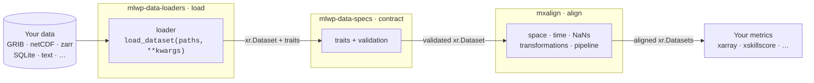

# The mlwp-tools ecosystem

mxalign is the top layer of three small packages from
[mlwp-tools](https://github.com/mlwp-tools). Each one does a single job, and
they share one data model: **everything is an `xr.Dataset`**.



| Layer | Package | Job |
|---|---|---|
| **Contract** | [`mlwp-data-specs`](https://github.com/mlwp-tools/mlwp-data-specs) | Defines the three [traits](traits.md) and the dimensions, coordinates and metadata each one requires. Validates datasets against them. |
| **Load** | [`mlwp-data-loaders`](https://github.com/mlwp-tools/mlwp-data-loaders) | Turns files into `xr.Dataset`s with traits attached, then validates them. Ships loaders for common sources and accepts your own. |
| **Align** | **`mxalign`** | Reads the traits and aligns datasets in space and time, then scales this up with a Dask pipeline. |

The split is recorded in
[ADR-001](../adr/ADR-001_seperate-validation-and-loading.md). Its effect is
that mxalign never needs to know which file format a dataset came from. It
only looks at the traits.

## Why not one reader for every format?

Meteorological data comes in many formats: GRIB, netCDF and zarr forecasts,
FA files, ODIM radar volumes, SQLite observation tables, plain-text station
files. Each has its own dimension names, units and time conventions.

One approach, taken by libraries such as
[earthkit-data](https://earthkit-data.readthedocs.io), is a general reader that
understands every format. mlwp-tools takes the opposite approach. It defines a
minimal **contract** for what a verification-ready dataset looks like and
leaves reading the format to whoever knows the data best: you.

## Bring your own loader

A loader is any Python module, or a standalone `.py` file, that defines one
function:

```python
def load_dataset(paths, **kwargs) -> xr.Dataset: ...
```

It opens the files, renames dimensions and coordinates to the contract's
names, adds the required coordinate metadata, and sets the three trait
attributes. A loader for a station file whose station dimension is called
`code` can be this short:

```python title="myloader.py"
import xarray as xr


def load_dataset(file):
    ds = xr.open_mfdataset([file], engine="h5netcdf")

    ds = ds.rename_dims(code="point_index")

    ds.attrs["mlwp_time_trait"] = "observation"
    ds.attrs["mlwp_space_trait"] = "point"
    ds.attrs["mlwp_uncertainty_trait"] = "deterministic"

    ds.coords["valid_time"].attrs["standard_name"] = "time"
    ds.coords["latitude"].attrs.update(
        {"standard_name": "latitude", "units": "degrees_north"}
    )
    ds.coords["longitude"].attrs.update(
        {"standard_name": "longitude", "units": "degrees_east"}
    )

    return ds
```

Pass the loader to `load_and_validate_dataset` as a path to the `.py` file or
as a dotted module path. Extra keyword arguments are forwarded to
`load_dataset`:

```python
from mlwp_data_loaders import load_and_validate_dataset

ds_obs = load_and_validate_dataset("synop.nc", loader="myloader.py")
ds_fcst = load_and_validate_dataset(
    "forecast.nc",
    loader="mlwp_data_loaders.loaders.anemoi.anemoi_inference",
)
```

If the result breaks the contract, `load_and_validate_dataset` raises a
`ValueError`. Pass `return_validation_report=True` to get the dataset together
with a report listing each check, and call `report.console_print()` to see
which checks failed.

!!! tip "Loaders that ship with mlwp-data-loaders"
    `mlwp_data_loaders.loaders.anemoi.anemoi_inference`,
    `mlwp_data_loaders.loaders.anemoi.anemoi_datasets`,
    `mlwp_data_loaders.loaders.harp.obstable` (HARP SQLite observation tables)
    and `mlwp_data_loaders.loaders.ifs.forecast` (IFS GRIB, needs the `ifs`
    extra).

## Where mxalign stops

mxalign hands you aligned `xr.Dataset`s and stops there. Scores are computed
with whatever you prefer: plain `xarray`, `xskillscore`, or your own code. The
[config-driven pipeline](../user-guide/pipeline.md) can call any such
function by its import path, but mxalign doesn't define metrics itself.
